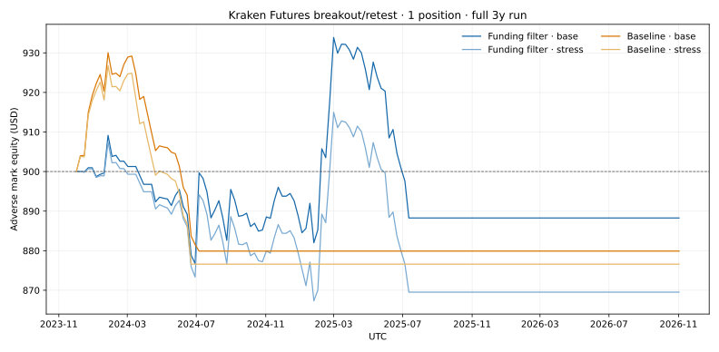
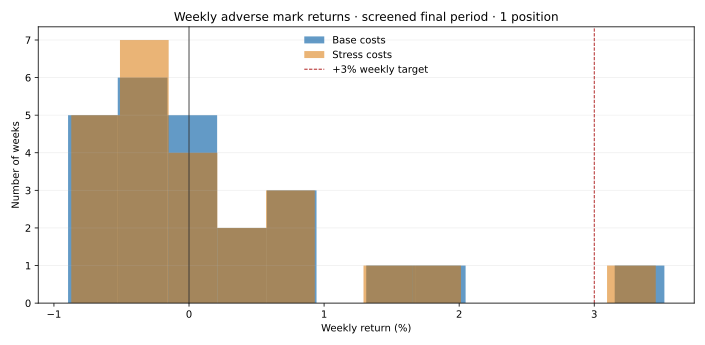

# Trading Quant — research update, 2 Nov 2026

## Decision

**No strategy qualifies for paper trading.** No untouched out-of-sample period exists, no tested configuration demonstrates a statistically credible positive weekly return, and none approaches a defensible +3% average net week at the specified risk budget. No live orders were submitted.

The strongest positive chronological slice is the previously screened 22 May–2 Nov 2026 period. It is not independent evidence: many earlier strategy and filter choices were evaluated on it. The 1-position funding-filter version returned +5.37% base / +3.96% stress on that slice, yet lost 1.30% in the 2023–25 training window, lost 1.87% in WF2, and hit the portfolio drawdown kill switch in the training window. Reject it as a qualified edge.

## Data and reproducibility

- Kraken Futures linear perpetual 1h candles for BTC, ETH, SOL, XRP run from 2 Nov 2023 through 2 Nov 2026, with matching 4h and 1d files. Candle audit: gapless.
- I merged Kraken’s downloadable historical funding export with the previously downloaded API series. Each asset now has 26,308 of 26,316 hourly rates (99.9696% coverage); eight hours are missing per asset and left unfilled. In the 2,243-hour overlap, all four assets match exactly. Funding is charged hourly while a position is open.
- Portfolio costs: 5 bps fee per side; baseline spread/slippage friction 3 bps per side; stress friction 7.5 bps per side. Market entries/exits are modeled with OHLC bars, adverse intrabar stop ordering, and adverse-price liquidation on risk-kill bars. This remains a bar-data approximation; it does not simulate queue position, partial fills, latency, mark-price liquidation, or live funding publication delays.
- Each configuration starts with $900. The 1–4 position runs share a fixed total 0.25% initial stop-risk budget, divided evenly among available slots. Per-position notional cap is 0.75× equity, so the aggregate model exposure cannot exceed 2× for four positions. Strategy signals are 1h breakout/retest aligned with the 4h EMA50/EMA200 trend. The adverse-funding filter rejects a candidate if its side would pay ≥2 bp/hour based on the last known prior hourly rate.
- Daily -1%, UTC Monday-week -3%, and peak-to-trough -6% controls now liquidate open positions at the adverse bar extreme plus modeled friction. The drawdown threshold permanently disables new entries for that run. OHLC gaps and execution costs can cause a small realized overshoot; observed 1-position breaches were about 0.02–0.07 percentage points. Limits are not mathematical guarantees in live trading.
- Reproduce: `python -m src.merge_funding_history`, `python -m src.audit_data`, `python -m src.full_history_portfolio_screen`. Input hashes, script hashes, trade ledgers, metrics, and hourly equity curves are saved under `results/`.

## Chronological portfolio results

Returns are net of modeled fees, friction, and funding. Each period is independently initialized at $900. Values are `net return / max drawdown / trades / profit factor`. `screened` means it was repeatedly examined during prior research; it is not an untouched holdout.

| Signal / positions (total open stop risk 0.25%) | Train 2 Nov 2023–30 Oct 2025, base / stress | WF1 30 Oct 2025–1 Feb 2026, base / stress | WF2 1 Feb–22 May 2026, base / stress | Screened 22 May–2 Nov 2026, base / stress | Combined 3y run, base / stress |
|---|---|---|---|---|---|
| Breakout/retest, 1 | -2.23% / -6.01% / 94 / 0.83; -2.60% / -6.00% / 88 / 0.80 | +2.00% / -3.04% / 34 / 1.44; +1.57% / -3.14% / 34 / 1.35 | -2.06% / -4.11% / 49 / 0.72; -3.05% / -4.44% / 51 / 0.60 | +4.86% / -2.06% / 70 / 1.56; +2.95% / -2.45% / 71 / 1.33 | -2.23% / -6.01% / 94 / 0.83; -2.60% / -6.00% / 88 / 0.80 |
| Breakout/retest + funding filter, 1 | -1.30% / -6.02% / 198 / 0.95; -3.39% / -6.07% / 197 / 0.87 | +2.00% / -3.04% / 34 / 1.44; +1.57% / -3.14% / 34 / 1.35 | -1.87% / -3.93% / 48 / 0.73; -2.88% / -4.27% / 50 / 0.61 | +5.37% / -2.18% / 66 / 1.66; +3.96% / -2.21% / 65 / 1.48 | -1.30% / -6.02% / 198 / 0.95; -3.39% / -6.07% / 197 / 0.87 |
| Breakout/retest, 2 | +3.97% / -3.69% / 473 / 1.12; +1.00% / -4.44% / 474 / 1.03 | -0.76% / -3.51% / 64 / 0.84; -0.99% / -3.55% / 64 / 0.79 | -1.82% / -3.09% / 79 / 0.70; -2.44% / -3.42% / 81 / 0.61 | +1.27% / -1.71% / 113 / 1.17; +0.29% / -1.77% / 113 / 1.04 | +2.71% / -5.10% / 728 / 1.05; -2.82% / -6.02% / 653 / 0.94 |
| Breakout/retest + funding filter, 2 | +2.96% / -2.77% / 361 / 1.12; +0.60% / -3.07% / 361 / 1.02 | -0.76% / -3.51% / 64 / 0.84; -0.99% / -3.55% / 64 / 0.79 | -1.73% / -3.00% / 78 / 0.71; -2.36% / -3.34% / 80 / 0.61 | +1.29% / -1.49% / 105 / 1.18; +0.35% / -1.61% / 105 / 1.05 | +1.82% / -4.97% / 607 / 1.04; -3.35% / -6.01% / 541 / 0.91 |
| Breakout/retest, 3 | +1.43% / -2.98% / 538 / 1.06; -0.92% / -3.54% / 539 / 0.96 | -0.87% / -3.31% / 84 / 0.80; -1.07% / -3.34% / 84 / 0.75 | -1.49% / -2.42% / 94 / 0.69; -1.86% / -2.73% / 95 / 0.61 | +1.14% / -1.34% / 133 / 1.20; +0.40% / -1.39% / 133 / 1.07 | +0.27% / -4.41% / 848 / 1.01; -3.34% / -5.16% / 850 / 0.91 |
| Breakout/retest + funding filter, 3 | +0.55% / -2.28% / 405 / 1.03; -1.03% / -2.97% / 405 / 0.94 | -0.87% / -3.31% / 84 / 0.80; -1.07% / -3.34% / 84 / 0.75 | -1.38% / -2.31% / 91 / 0.70; -1.75% / -2.62% / 92 / 0.62 | +1.52% / -1.04% / 119 / 1.29; +0.78% / -1.23% / 119 / 1.15 | -0.12% / -4.05% / 698 / 1.00; -2.98% / -4.78% / 699 / 0.91 |
| Breakout/retest, 4 | +0.51% / -2.10% / 548 / 1.03; -1.50% / -3.38% / 549 / 0.92 | -0.85% / -2.78% / 91 / 0.76; -1.01% / -2.81% / 91 / 0.71 | -1.09% / -1.79% / 95 / 0.70; -1.37% / -2.03% / 96 / 0.62 | +1.26% / -0.98% / 140 / 1.29; +0.63% / -1.05% / 140 / 1.14 | -0.14% / -3.55% / 873 / 1.00; -3.17% / -4.78% / 875 / 0.89 |
| Breakout/retest + funding filter, 4 | +0.44% / -1.83% / 410 / 1.03; -0.76% / -2.17% / 410 / 0.94 | -0.85% / -2.78% / 91 / 0.76; -1.01% / -2.81% / 91 / 0.71 | -1.01% / -1.71% / 92 / 0.71; -1.29% / -1.95% / 93 / 0.63 | +1.25% / -0.74% / 124 / 1.32; +0.65% / -0.87% / 124 / 1.17 | -0.13% / -3.28% / 716 / 0.99; -2.33% / -3.77% / 717 / 0.90 |

More slots increase turnover and did not improve robustness. The two-position baseline has the best base-cost three-year compounded result (+2.71%), but falls to -2.82% under stress and loses in both WF windows; this does not establish an edge. One-position cases do not meet the 200 trade OOS threshold in the already-screened final interval. More active portfolios exceed 200 trades in some periods, but all those data have already influenced research choices.

### Weekly returns and uncertainty

For the 1-position filtered strategy in the screened final interval (23 weekly observations), mean weekly adverse-mark return was +0.222% base and +0.164% stress; median +0.049% and +0.008%; positive weeks 56.5% each; worst week -0.80% and -0.95%. A circular 4-week block bootstrap (5,000 draws, seed 20261102) gives 95% intervals of -0.007% to +0.462% base and -0.045% to +0.378% stress. The interval spans zero, and the sample is screened. In WF2, mean weekly return was -0.117% base / -0.182% stress; intervals also span zero. This is nowhere near the +3% weekly objective.

The combined three-year 1-position runs reach the 6% drawdown stop and remain disabled; their return is the realized outcome after the kill switch, not a hypothetical continuously trading return. Their OOS interpretation is limited by the absence of untouched data. No point estimate or confidence interval here supports deployment.

## Other hypotheses and iteration decisions

The prior funding-era screens tested five signal families: breakout/retest with 4h trend, breakout/retest plus adverse funding, trend/range hybrid, ATR compression-to-expansion breakout filter, and BB(20,2σ)/RSI(14) mean reversion. In that earlier 1-year screen the hybrid, compression filter, and mean-reversion-only variant lost after costs. Those separate exploratory scripts used entry halts rather than the corrected hard liquidation rule and are not risk-compliant candidates; their numerical metrics are retained only as exploratory diagnostics. The corrected three-year portfolio engine was then applied to baseline and funding-filtered breakout across 1–4 positions. It rejects both as validated edges: WF instability and cost stress overwhelm the favorable screened slice.

No ranking of five *qualified* strategies is warranted. The best documented configurations above are research screens, not validated candidates. The immediate research boundary is historical-data limitations: there is no untouched future sample yet, no archived historical order book/trade-by-trade execution to calibrate spread/queue/impact, and funding export has eight missing hours per asset. A preregistered forward paper-trading evaluation would need to start only after freezing a strategy; there is no recommended candidate to paper trade now.

## Files

- `src/merge_funding_history.py` — obtain/merge Kraken funding export and API data, audit overlap and coverage.
- `src/full_history_portfolio_screen.py`, `src/portfolio_concurrency.py` — reproducible portfolio run with shared risk and hard liquidation.
- `results/full_history_portfolio/metrics.json` — metrics, hashes, risk-trigger counts.
- `results/full_history_portfolio/metrics_summary.csv` — compact comparison of returns, DD, PF, hit rate, costs, and trade counts across every slot count and chronological window.
- `results/full_history_portfolio/trades.csv` — full trade ledger, fees and funding.
- `results/full_history_portfolio/equity.csv` — hourly realized and adverse-mark equity.
- `results/full_history_portfolio/equity_curve_1pos_3y.svg`, `weekly_pnl_distribution_1pos_screened.svg`, `weekly_pnl_1pos_screened.csv` — equity curve and weekly return distribution.
- `results/full_history_individual/` — individual signal-family diagnostic screens.
- `data/processed/kraken_futures_*_funding_complete_1h.csv` — merged funding series and manifests; source archive is excluded from Git.

## Exchange sources

- [Kraken Futures funding rate history export](https://support.kraken.com/articles/360022835771-funding-rate)
- [Kraken Futures change to hourly funding](https://support.kraken.com/articles/360022635232-funding-rate-changes)
- [Kraken Futures contract specifications and trading fees](https://support.kraken.com/articles/360022835451-contract-specifications)
