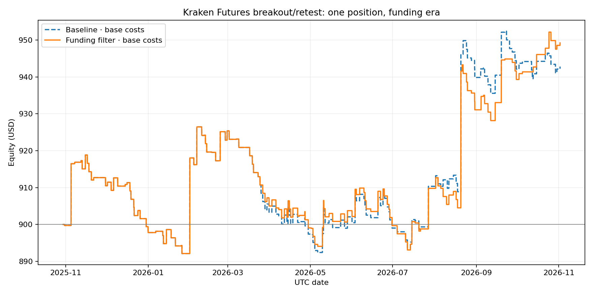
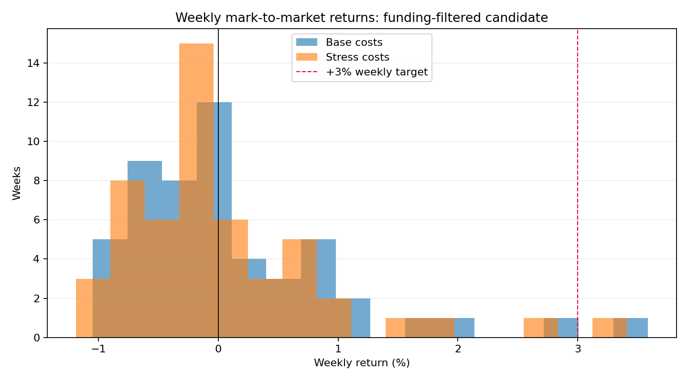

# Trading Quant — intraday research update, 2 Nov 2026

## Decision

**No strategy qualifies for paper or live promotion. The +3% average weekly net return objective is not achieved.** No orders were submitted. The best current *research candidate* is the one-position Kraken breakout/retest strategy with an adverse-funding crowding filter, but its edge is weak and statistically uncertain: the weekly block-bootstrap interval includes zero, the two middle chronological windows are not consistently positive, and the nominal final period is not untouched because many previous screens already evaluated it.

## Data and execution assumptions

- Kraken Futures linear perpetual trade candles: BTC, ETH, SOL and XRP, 1h / 4h / 1d, 2 Nov 2023 to 2 Nov 2026. Hourly funding is available only from 30 Oct 2025; funding is not imputed outside the published series. Funding coverage is complete in the reported funding-era windows.
- Starting equity: USD 900. One portfolio position risks 0.25% of equity to initial stop. Multi-position tests split that single 0.25% total stop-risk budget evenly across active slots. Maximum notional is 0.75× equity per position; observed aggregate exposure stayed below 0.53× equity in the filtered 1-position case and below the 2× leverage ceiling in all tested cases.
- Fees: 5 bps per side. Baseline execution friction: 3 bps per side (spread + slippage); stress: 7.5 bps per side. Historical hourly Kraken funding is charged to open positions.
- Stops use trade-candle OHLC, not mark-price ticks. Partial fills, queue position, latency, liquidation, and historical contract changes are not simulated. Results are a screening backtest, not execution proof.

## New hypotheses tested

1. **Funding crowding filter.** Keep the existing 1h breakout/retest + 4h EMA50/EMA200 directional setup. At the signal close, read the last already-observed funding rate. Reject a trade if its side would pay at least 2 bps per hour (`side × funding >= 0.00002`). Reject candidates without an observed prior funding value. This is a fixed economic threshold, not an optimized sweep.
2. **Trend / range hybrid.** Use breakout/retest in a confirmed 4h trend; use 1h Bollinger(20, 2σ) + RSI(14) mean reversion only when the 4h trend state is neutral. Range stop: 1.5 ATR, target: Bollinger middle, 24h time stop. Trend stop: 2 ATR, 3 ATR trail after +1R, 72h time stop.
3. **Volatility compression/expansion.** Require the prior 48h mean ATR to be no more than 80% of the prior 10d mean ATR, followed by breakout-hour ATR at least 125% of the 48h mean, before accepting a breakout/retest.
4. **Concurrency with shared risk.** Compare 1, 2, 3 and 4 simultaneous slots, allocating a fixed 0.25% total initial-stop risk across slots. Run both the baseline and funding-filtered signals. This corrects the earlier screen where each concurrent position could independently consume 0.25% risk.

## Candidate comparison — one position, 0.25% risk

All returns are compound net returns for each independent period, with baseline/stress execution costs.

| Candidate / period | Cost case | Net return | PF | Max DD | Trades | Win rate | Expectancy / trade |
|---|---|---:|---:|---:|---:|---:|---:|
| Breakout/retest, funding era (30 Oct 2025–2 Nov 2026) | Base | +4.76% | 1.231 | -4.11% | 153 | 37.9% | — |
| Breakout/retest | Stress | +1.38% | 1.065 | -4.95% | 156 | 34.6% | — |
| **Funding-filtered breakout/retest, same period** | **Base** | **+5.47%** | **1.275** | **-4.00%** | **148** | **38.5%** | **+$0.33** |
| **Funding-filtered breakout/retest** | **Stress** | **+2.54%** | **1.127** | **-5.01%** | **149** | **35.6%** | **+$0.15** |
| Trend/range hybrid, same period | Base | -3.71% | 0.760 | -6.03% | 101 |  — | — |
| Trend/range hybrid | Stress | -4.13% | 0.705 | -6.04% | 91 | — | — |
| Compression/expansion filter, same period | Base | -0.50% | 0.848 | -2.68% | 22 | — | — |
| Compression/expansion filter | Stress | -0.66% | 0.797 | -2.67% | 22 | — | — |
| BB/RSI mean reversion, same period | Base | -3.94% | 0.838 | -6.02% | 165 | 38.2% | — |
| BB/RSI mean reversion | Stress | -5.89% | 0.738 | -6.11% | 157 | 36.9% | — |

The two new strategy combinations (hybrid and compression filter) were rejected. The funding filter improved the baseline by about 0.7 percentage points in base costs and 1.2 points in stress, but that difference is too small to establish an edge on this reused sample.

## Walk-forward and screened holdout

| Period | Funding-filtered base | Funding-filtered stress | Baseline base | Baseline stress |
|---|---:|---:|---:|---:|
| WF1, 30 Oct 2025–1 Feb 2026 | +2.00% | +1.57% | +2.00% | +1.57% |
| WF2, 1 Feb–22 May 2026 | -1.87% | -2.88% | -2.06% | -3.05% |
| Final screened period, 22 May–2 Nov 2026 | +5.37% | +3.96% | +4.86% | +2.95% |

The final period is labelled **screened**, not untouched: prior research compared many strategies and filters on this same interval. Its 66 filtered-candidate trades do not satisfy the 200-trade OOS target. The funding-era aggregate has 148 trades but also contains the previously evaluated WF1, WF2 and final period; it is not an independent test.

## Weekly distribution and uncertainty — funding-filtered one-position candidate

Weekly returns use adverse mark-to-market equity. Sharpe and Sortino are annualized from weekly observations and are approximate. The 95% interval uses 5,000 circular 4-week block-bootstrap resamples of the mean weekly return.

| Period / costs | Mean week | Median week | Positive weeks | Weeks ≥ +3% | Worst week | Sharpe | Sortino | 95% block-bootstrap CI of mean |
|---|---:|---:|---:|---:|---:|---:|---:|---:|
| Funding era / base | +0.107% | -0.084% | 38.5% | 1 / 52 | -1.05% | 0.86 | 1.90 | -0.089% to +0.307% |
| Funding era / stress | +0.053% | -0.116% | 36.5% | 1 / 52 | -1.19% | 0.45 | 0.91 | -0.131% to +0.241% |
| Final screened / base | +0.223% | -0.071% | 47.8% | 1 / 23 | -1.05% | 1.62 | 3.88 | -0.023% to +0.488% |
| Final screened / stress | +0.165% | -0.095% | 47.8% | 1 / 23 | -1.19% | 1.24 | 2.77 | -0.055% to +0.398% |

For the full funding era, the weekly mean does not differ reliably from zero. The one observed +3% week in 52 weeks is not evidence of a repeatable +3% weekly process. No tested candidate approaches a 3% average week under the stipulated risk budget.





## 1–4 positions under the same total 0.25% initial-stop risk

| Candidate | Slots | Funding-era return base / stress | Final screened return base / stress | Funding-era max DD base / stress |
|---|---:|---:|---:|---:|
| Baseline breakout/retest | 1 | +4.76% / +1.38% | +4.86% / +2.95% | -4.11% / -4.95% |
| Baseline breakout/retest | 2 | -1.33% / -3.13% | +1.27% / +0.29% | -4.46% / -5.40% |
| Baseline breakout/retest | 3 | -1.23% / -2.52% | +1.14% / +0.40% | -3.66% / -4.25% |
| Baseline breakout/retest | 4 | -0.70% / -1.75% | +1.26% / +0.63% | -3.01% / -3.41% |
| Funding-filtered breakout/retest | 1 | +5.47% / +2.54% | +5.37% / +3.96% | -4.00% / -5.01% |
| Funding-filtered breakout/retest | 2 | -1.22% / -2.99% | +1.29% / +0.35% | -4.48% / -5.39% |
| Funding-filtered breakout/retest | 3 | -0.75% / -2.04% | +1.52% / +0.78% | -3.56% / -4.08% |
| Funding-filtered breakout/retest | 4 | -0.63% / -1.64% | +1.25% / +0.65% | -2.94% / -3.30% |

One position remains the best total-period choice. More simultaneous positions lower the funding-era result; the apparent smaller drawdown for 3–4 slots comes with substantially lower returns. No tested allocation breached 2× observed notional exposure. Daily/weekly loss thresholds and drawdown stops currently halt new entries in the shared engine; open positions are not forcibly liquidated at the threshold, so those controls are not a hard guarantee against gap losses.

## Reproducibility and next experiment

On Python 3.11+, from the repo root:

```bash
python -m src.audit_data
python -m src.funding_crowding_screen
python -m src.hybrid_regime_screen
python -m src.volatility_compression_screen
python -m src.shared_risk_concurrency_screen
python -m src.analyze_funding_filter
python -m src.plot_research_results
```

Every script writes its fixed configuration through code, SHA-256 hashes of input series and strategy code, metrics JSON, trade ledger and equity curve under `results/`. The raw price/funding series and their manifests are retained in `data/raw/`.

**Next:** do not tune the current 2 bp threshold on the screened holdout. Verify the Kraken funding field timing and economics from the exchange documentation, then pre-register the next test against a genuinely future holdout; obtain mark-price / order-book data or keep execution claims explicitly provisional. Any paper promotion requires a longer forward sample and stricter hard-stop behavior.
